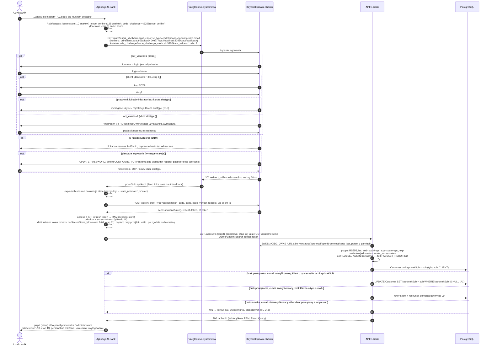
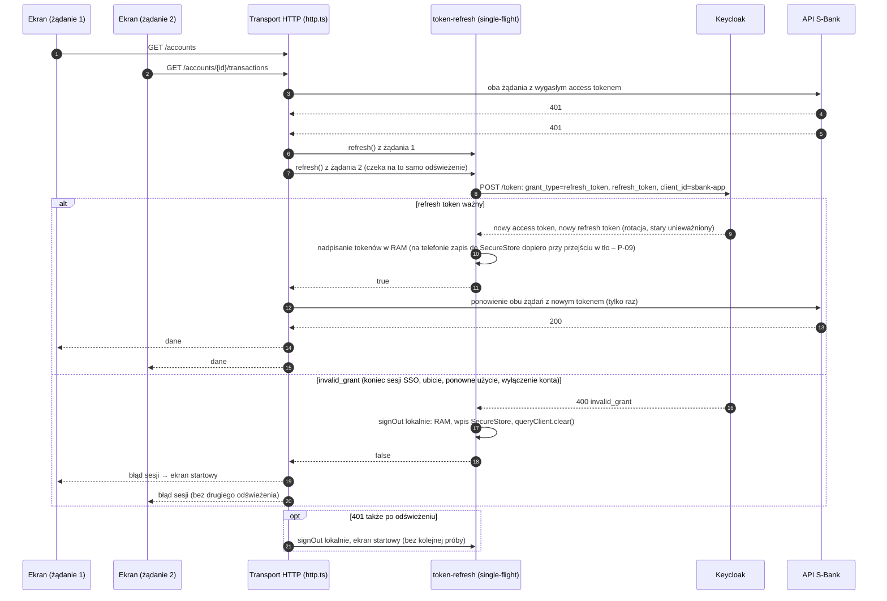
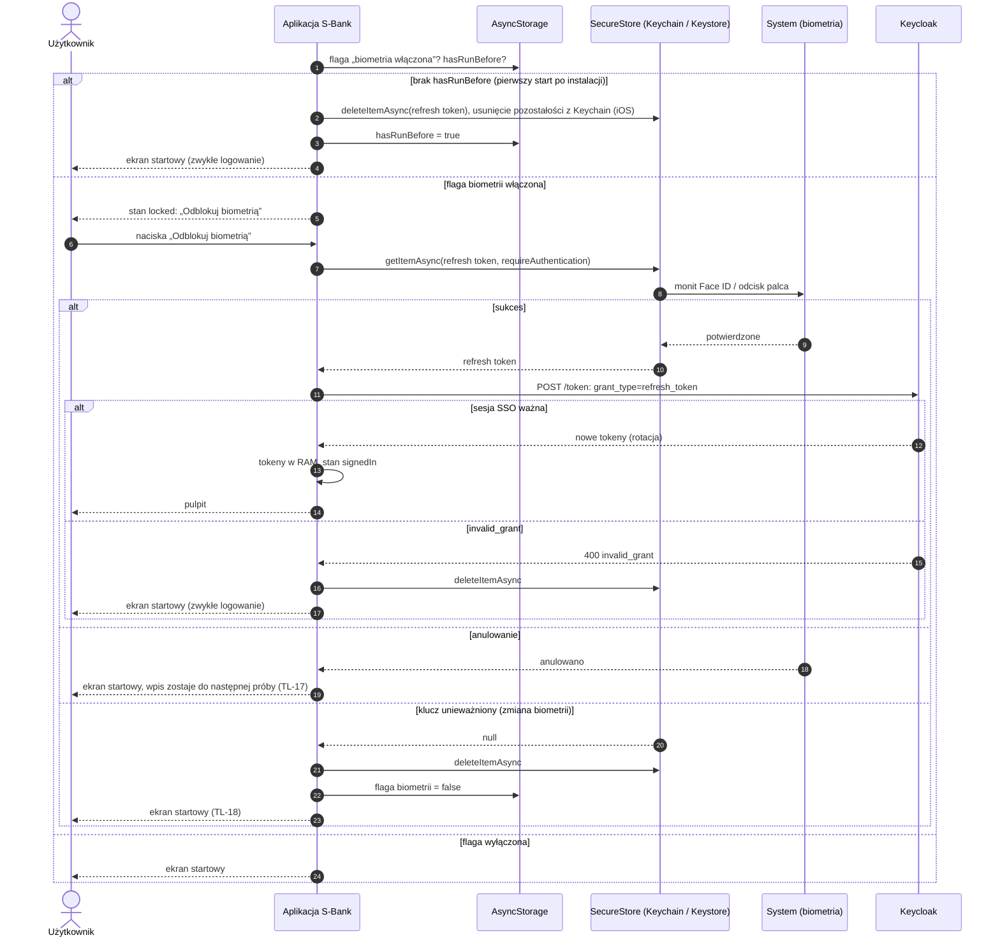
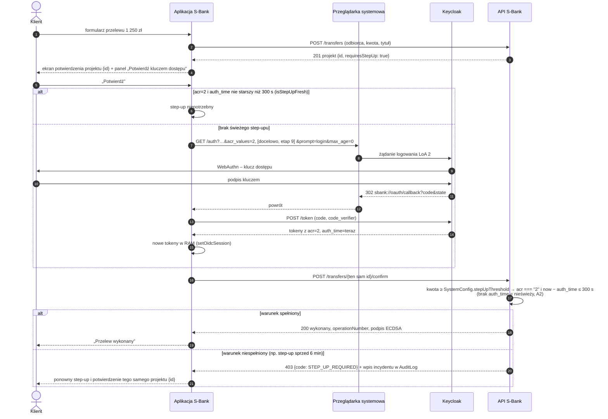
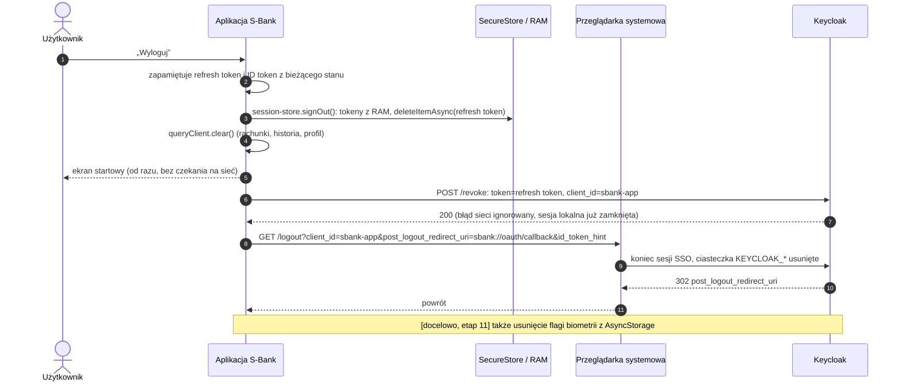
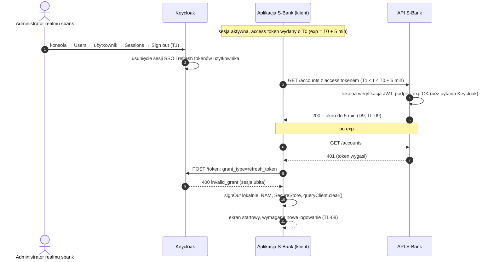
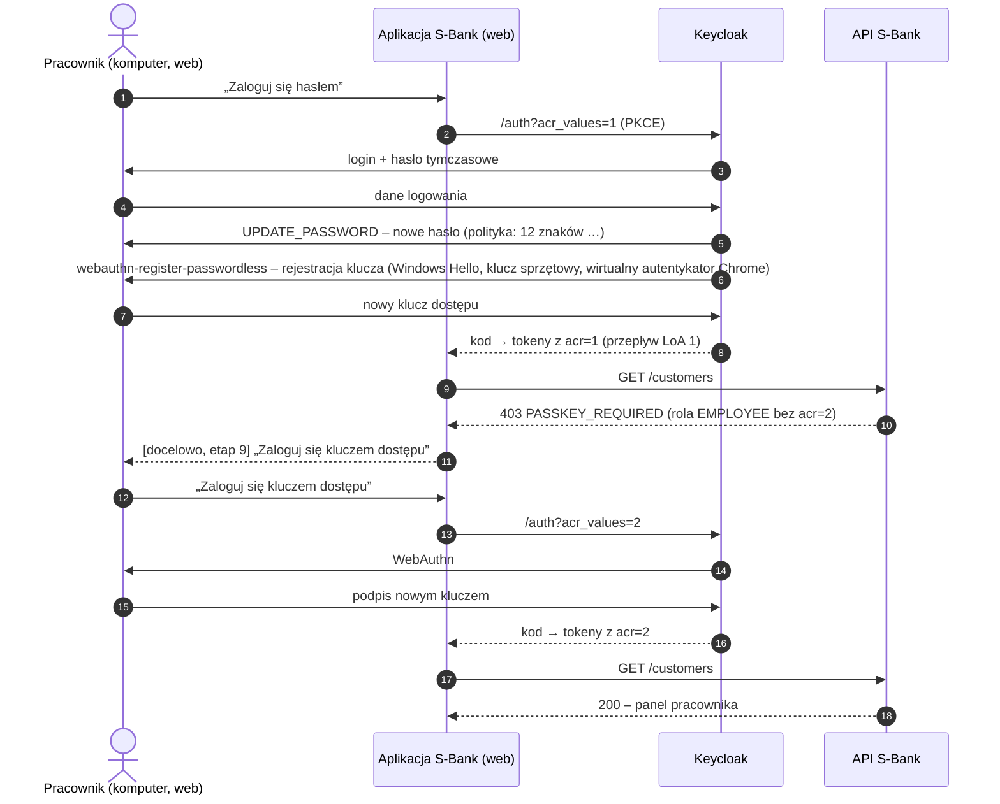

# Diagramy sekwencji logowania – etap 4 (2026-11-25)

Nazwy tras, endpointów i parametrów pochodzą z kodu (`app/src/shared/auth/oidc.ts`, `SessionProvider.tsx`, `session-store.ts`, `api/src/auth/jwt-auth.guard.ts`, `api/src/accounts/*`), z realmu `infra/keycloak/sbank-realm.json` i z decyzji `docs/auth/01-decyzje.md`. Kroki, których jeszcze nie ma w kodzie, mają dopisek **[docelowo, etap N]**.

**Wspólne nazwy:**

- **Wystawca:** `http://localhost:8080/realms/sbank` (stały po P-04). Endpointy: `…/protocol/openid-connect/auth`, `/token`, `/revoke`, `/logout`, `/certs`.
- **Klient:** `sbank-app`, publiczny, PKCE S256.
- **Powrót z logowania:** `sbank://oauth/callback` (telefon), `http://localhost:8081/oauth/callback` (web) – D14, P-01.
- **API:** `http://localhost:3000`, bez prefiksu `/api`.

**Zmiany z etapu 9 (2026-11-26):**

- **P-17, web:** zamiast wyskakującego okna karta przechodzi do Keycloak i wraca na `/oauth/callback`. Na czas przekierowania `state`, `code_verifier` i `nonce` leżą jednorazowo w `sessionStorage`.
- **P-15:** „Zaloguj się kluczem dostępu” wysyła też scope `sbank-passkey-login`, więc Keycloak prosi od razu o klucz, bez hasła.
- **P-16:** strona Keycloak ma motyw S-Bank.

## 1. Logowanie (diagram główny)

**Opis:**

- **Hasło, kod TOTP i klucz dostępu** trafiają wyłącznie do Keycloak w przeglądarce systemowej. Aplikacja dostaje tylko kod autoryzacyjny i wymienia go na tokeny z `code_verifier` (SR-01, T-04).
- **`state` sprawdza biblioteka** `expo-auth-session`. `nonce` dodaje etap 9.
- **API ufa wyłącznie podpisanemu tokenowi.** Powiązanie z klientem w banku powstaje tylko przez `keycloakSub` albo przy pierwszym logowaniu ze zweryfikowanym e-mailem (A1). Wynik dekodowania tokenu w aplikacji (principal) służy tylko do wyświetlania.

## 2. Odświeżenie tokenu przy 401 – [docelowo, etap 10]

**Opis:**

- **Jedno odświeżenie na wiele żądań.** Gdyby każde żądanie odświeżało osobno, drugie użyłoby już unieważnionego refresh tokenu. Przy `refreshTokenMaxReuse 0` Keycloak unieważniłby wtedy całą sesję (TL-10).
- **Limit czasu żądania** to 15 s (etap 10).

## 3. Odblokowanie biometrią po ponownym uruchomieniu (telefon) – [docelowo, etap 11]

**Opis:**

- **Tokeny w RAM:** access token nigdy nie trafia na dysk, a refresh token przetrwa restart tylko za zgodą na biometrię (SR-09).
- **Monit przy zapisie na Androidzie:** zapis do SecureStore z `requireAuthentication` też pokazuje monit (dokumentacja SDK 57). Dlatego zapis następuje raz, przy przejściu w tło, a nie po każdej rotacji (D17).

## 4. Step-up przy przelewie ≥ 1 000 zł

**Opis:**

- **Potwierdzenie dotyczy identyfikatora projektu,** więc kwoty nie da się podmienić po step-upie (SR-07, T-05).
- **Krok aplikacji to tylko wygoda,** bo próg i świeżość sprawdza API. Płatność z linku lub QR (`POST /payment-requests/{id}/pay`) przechodzi przez tę samą kontrolę step-upu.
- **`prompt=login` i `max_age=0`** zmuszą Keycloak do ponownego użycia klucza, zamiast wydać tokeny z istniejącej sesji SSO (etap 9).

## 5. Wylogowanie

**Opis:**

- **Kolejność jak w `SessionProvider.signOut`:** najpierw czyszczenie lokalne, potem wylogowanie w Keycloak. Nawet bez sieci w aplikacji nie zostają tokeny ani dane finansowe.
- **Po wylogowaniu stary refresh token daje `invalid_grant`,** a w konsoli Keycloak nie ma sesji (TL-07).

## 6. Ubicie sesji przez administratora i okno do wygaśnięcia access tokenu

**Opis:**

- **Okno do 5 min:** API nie pyta Keycloak przy każdym żądaniu (D9), więc ubity użytkownik działa jeszcze najwyżej do `exp`.
- **To samo dotyczy** wyłączenia konta (TL-11) i odebrania roli (TL-12): zmiana zadziała przy najbliższym odświeżeniu.
- **Natychmiastowe odcięcie** wymagałoby introspekcji tokenu w API, czyli zmiany architektury.

## 7. Pierwsze logowanie pracownika / administratora (D16)

**Opis:**

- **Potwierdzone w etapie 7 (2026-11-26), po P-13.** Pracownik, który ma już klucz, nie może zalogować się hasłem: podprzepływ `Deny access` pokazuje „Pracownik i administrator logują się kluczem dostępu.”
- **Administrator przechodzi tę samą drogę** z rolą `admin` i trasą `/users`.
