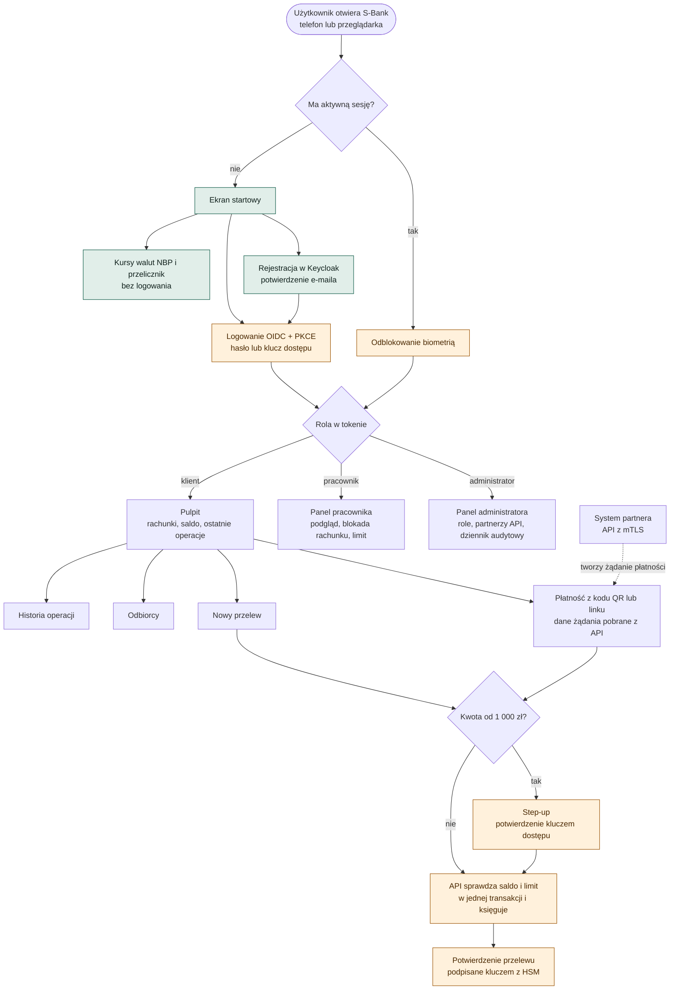
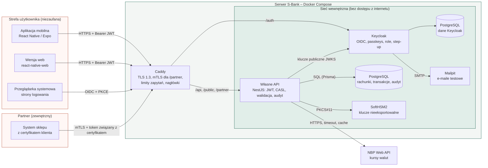
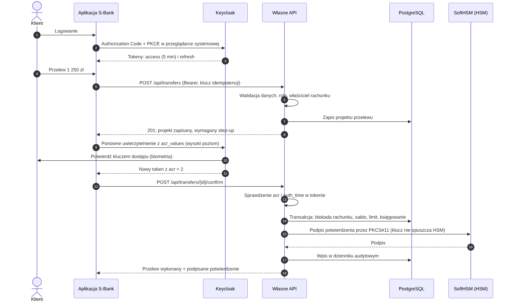
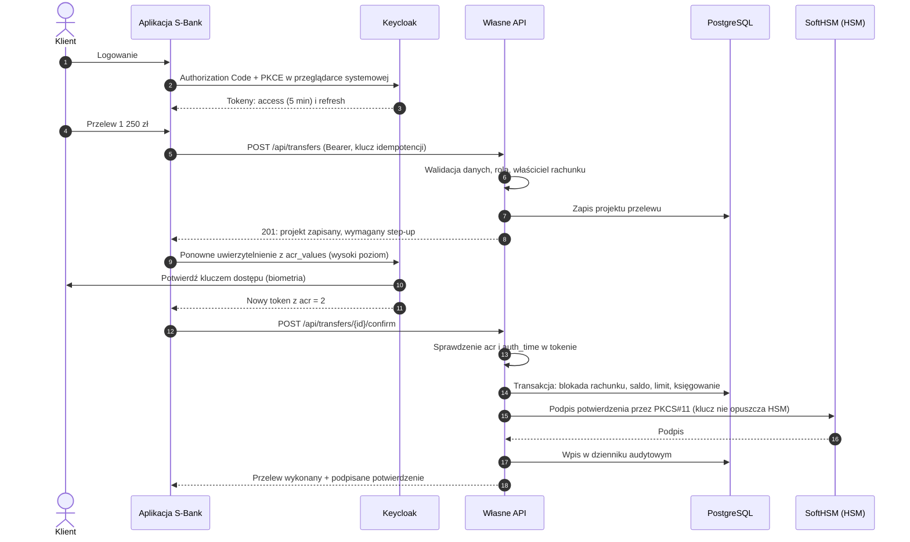

# Diagramy – S-Bank

Schemat działania aplikacji, architektura i przebieg najważniejszej operacji. Kod Mermaid poniżej GitHub wyświetla jako diagram; te same diagramy są w plikach PNG obok.

## 1. Schemat działania aplikacji

Droga użytkownika od uruchomienia aplikacji: funkcje publiczne, rejestracja i logowanie, rozdział według roli i przebieg płatności. Elementy pomarańczowe to punkty kontroli bezpieczeństwa, zielone – funkcje dostępne bez logowania.

## 2. Architektura i przepływ danych

Komponenty, granice zaufania i protokoły między nimi. Z internetu dostępny jest tylko Caddy; API, Keycloak, bazy i HSM działają w sieci wewnętrznej.

## 3. Przelew z dodatkowym potwierdzeniem (step-up)

Przebieg podstawowej czynności – przelewu od 1 000 zł: logowanie OIDC z PKCE, projekt przelewu zapisany na serwerze, potwierdzenie kluczem dostępu, sprawdzenie poziomu `acr` przez API, księgowanie w jednej transakcji, podpis potwierdzenia w HSM i wpis w dzienniku audytowym.

